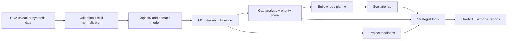

# VECTOR AI — Workforce Capability & Skills Intelligence
The right skills. At the right time.

## Business problem
Organisations can have enough people overall and still miss deadlines because the right skills are not available at the right time. VECTOR AI links employee skills, availability and workload to project requirements, deadlines and training lead times, finds critical gaps and compares ways to close them. Bundled data is **fictional synthetic data**.

## Features
Skills inventory with verified / self-reported / inferred distinction, demand vs supply with six distinct gap types, editable priority score, project readiness, constrained allocation optimiser with baseline comparison and constraint verification, build-or-buy comparison (redeploy, train, hire, contract, resequence), scenario lab, deterministic strategist (optional LLM), CSV exports and executive action plan.

## Architecture


## Run
```
pip install -r requirements.txt
python app.py
```
Google Colab: paste `app.py` into one cell and run it. `src/` modules from the master brief are consolidated into `app.py` (sections: validation, analytics, optimiser, planner, scenarios, strategist, reporting).

## Data, methodology, constraints
See `docs/data_dictionary.md`, `docs/methodology.md`, `docs/optimization_constraints.md`. Column mapping: enter `field=your_column` pairs in the Reports & Data tab.

## LLM
Off by default. Set `ANTHROPIC_API_KEY` (see `.env.example`) and tick the option; only aggregated results with employee IDs removed are sent.

## Tests
```
pip install pytest
pytest tests
```

## Responsible AI and limitations
See `docs/responsible_ai.md` and `docs/limitations.md`. Planning support only: human review is required before any staffing or hiring decision. Add screenshots to `screenshots/`.
